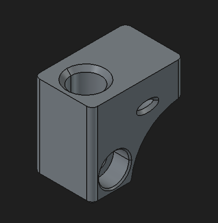
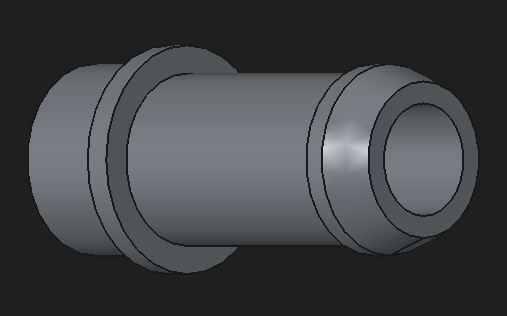

# Inline FTP pressure tap

This printed block provides a pressure-sensing connection in the catch-can outlet line, upstream of the PCV restrictor. Vapor passes through the horizontal bore between two separate hose barbs. A small internal passage connects that bore to the FTP sensor pocket on top, allowing the sensor to observe line pressure without making its sensing port a continuous vent.

The tap measures local line pressure. Hose and catch-can losses can make this differ from pressure inside the crankcase; comparison and calibration remain part of the [test plan](../../docs/testing/test-plan.md). See [A04](../../hardware/architecture/pcv-system.md) for intended placement and [P04](../../hardware/pinouts/ftp-sensor.md) for the sensor's electrical and pressure interfaces.

**Fabrication status:** the pressure tap is reported printed in PAHT-CF. Annealing with the PCV restrictor is planned; completion, process settings and post-anneal measurements have not been reported. Separate barb print quantity, bonding/sealing, sensor retention and installed leak performance remain unrecorded. This supersedes the historical context's earlier preference against annealing; it does not prescribe an annealing process.

## Files

| Part | Native source | Mesh export | Slicer project |
| --- | --- | --- | --- |
| Pressure-tap block | [FreeCAD](source/pressure-tap.FCStd) | [STL](exports/pressure-tap.stl) | [3MF](printing/pressure-tap.3mf) |
| Separate hose barb | [FreeCAD](source/pressure-tap-hose-barb.FCStd) | [STL](exports/pressure-tap-hose-barb.stl) | [3MF](printing/pressure-tap-hose-barb.3mf) |

The assembly has two barb receivers; the separate barb model serves both sides. Slicer projects are stored in `printing/`. Both 3MF projects identify QIDI Studio settings for X-Plus 4, a 0.4 mm nozzle, 0.2 mm layers and the QIDI PAHT-CF profile. These are saved settings, not a verified print log. Export tessellation settings and exact source-to-export revision history were not supplied.

## Saved block geometry

Dimensions are in millimeters. Use the native feature tree as the authority; these are design dimensions, not measurements of the print. In model coordinates the base occupies X=0..21, Y=-33..0, Z=0..31. The sensor pocket is centered at X=10.5, Y=-8.2 on the top face Z=31. The flow-bore axis runs across the width at Y=-8.2, Z=8.1.

| Feature | Saved CAD |
| --- | --- |
| Base envelope, width x length x height | 21 x 33 x 31 |
| Sensor pocket | **10.8 diameter**, 15 feature depth from the top; entry chamfer included in the final shape |
| Pocket center | 10.5 across width; 8.2 from the Y=0 end |
| Pressure-sensing passage | 3 diameter; 22.9 feature depth from the same top face |
| Main flow bore | 6.4 diameter, through the 21 width |
| Main bore center | 8.2 from the Y=0 end; 8.1 above the bottom |
| Both barb receivers | 11 diameter x 6 feature depth, coaxial with the main bore; chamfered entries |
| Other features | Retention slot, underside material relief, rounded base corners and edge chamfers |

The 22.9 mm sensing-pocket depth reaches the main bore center because `31 - 22.9 = 8.1`. After the larger pocket and flow bore are removed, only the connecting portion of that feature remains as a visible 3 mm passage.

### Reconciliation with the rough notes

- The rough notes say **9.5 mm** for the sensor pocket; the saved sketch and finished cylindrical surface are **10.8 mm**. The documentation follows CAD without changing the model. Establish the actual seal fit on the printed part.
- The quoted **0.45 in bushing** dimension converts to **11.43 mm**. Its dimensional meaning and actual fit are not established; it is not another way to write either 9.5 or 10.8 mm. The vendor's pressure-port-area callout also does not define a compatible bushing. Keep this under [Q22](../../docs/open-questions.md).
- The design-envelope calculation `15 + 3 + 9.8 + 3 = 30.8`, rounded to 31, explains the initial height. The actual flow bore is 6.4 mm; **9.8 mm is a barb/body envelope**, not the flow-bore diameter.
- `3.2 + 9.8 / 2 = 8.1` agrees with the saved main-bore center height. At that center, the 11 mm receiver leaves 2.6 mm to the nominal bottom plane, while the 6.4 mm bore leaves 4.9 mm. Neither should be described as a uniform 3 mm wall. Reliefs and chamfers require local assessment.

## Separate hose-barb geometry and joint

| Feature | Saved CAD, mm |
| --- | ---: |
| Overall length | 26.4 |
| Through bore | 6.4 diameter |
| Receiver spigot | 10.9 diameter x 5.9 long |
| Stop shoulder | 13 diameter x 1.5 thick |
| Straight hose section after shoulder | 9.8 diameter x 15 long |
| Retention crest | 10.9 diameter |
| Tip feature | 4 long, with chamfered entry |

The 10.9 mm spigot in an 11 mm receiver has **0.1 mm nominal diametral clearance**; the 5.9 mm spigot is 0.1 mm shorter than the 6 mm receiver depth. This is not a modeled interference fit or a demonstrated pressure-tight joint. Decide and record the sealing/retention method for both barbs, along with the sensor bushing fit. Printed and annealed dimensions may differ from CAD; verify those interfaces before installation. Preserve the sensor's required atmospheric reference and support the sensor and hoses without relying only on their seals.

## Model views

These supplied exports illustrate CAD, not completed physical assembly or measured fit.

Additional views: [opposite perspective](../../media/diagrams/pressure-tap/pressure-tap-2.png), [underside](../../media/diagrams/pressure-tap/pressure-tap-3.png), [right side](../../media/diagrams/pressure-tap/pressure-tap-right-side.png), [top](../../media/diagrams/pressure-tap/pressure-tap-top.png), and [barb side](../../media/diagrams/pressure-tap/pressure-tap-hose-barb.png).

## Validation and provenance

The supplied native sources open and fully recompute in FreeCAD 1.1.1 with one valid solid each, no invalid objects and unchanged volumes. Base sketch/pad dimensions and tessellated bounds agree at 21 x 33 x 31 mm. The barb has a 13 mm maximum diameter and 26.4 mm length. FreeCAD's conservative final B-rep bounding box overestimates the block envelope; it is not used as a fabrication dimension here.

Both STL meshes report closed solids. Both 3MF meshes have valid triangle indices and two triangles per undirected edge. Centered 3MF vertices agree with the corresponding STL vertices within 0.000002 mm. The exported block volume differs from native CAD by approximately 0.023%; the coarser barb mesh differs by approximately 0.99%. These comparisons support mesh consistency, not exact source-revision identity, print quality or a full self-intersection/slicer validation. No geometry or saved print settings were changed during this audit.

The CAD and exports were supplied directly in the repository; nine CAD PNG views were supplied in the 2026-10-10 catch-up batch (seven for this assembly and two for the restrictor). Public PNG copies preserve dimensions and pixels while removing metadata; visible views contain no personal information. Native document identity fields were empty, and the inspected archive XML/configuration contained no local user paths or email addresses. Native sources, meshes and slicer projects were retained unchanged; backup files remain ignored. The [restrictor guide](../pcv-restrictor/README.md) links its additional views.

Before recording this assembly as installed or validated, record annealing completion/settings, the actual restrictor variant, post-process dimensions, barb sealing/retention, sensor fit/reference clearance and leak checks. [Q22](../../docs/open-questions.md) remains open for that integration work.
