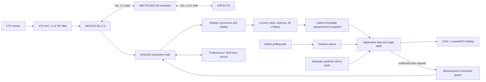

# Architecture: Live Sensor-to-Display Measurement Path

## Purpose and scope

This document describes the design for the approved [M02 feature](feature.md), informed by its
[research](research.md). M02 adds a live FTP-sensor measurement path, retains the synthetic M01
demonstration as a separate build, and adds a user-confirmed atmospheric zero adjustment. It defines
module responsibilities, data ownership, and test boundaries. The implementation sequence belongs
in the plan and tasks documents.

The N16R8 and the existing GC9A01/LVGL interface are the M02 bench target. The design follows W01:
the FTP sensor and ADS1115 share nominal 5 V, the analog signal passes through the built `470 ohm` /
`1 uF` RC input filter to A0, and the ADS1115's I2C bus passes through the hiBCTR BSS138 translator
to ESP32-S3 3.3 V logic. The purchase listing and BOM select the ADS1115 as the working device.
Routine rail, bus, and voltage-input checks are commissioning work; they do not block this software
architecture.

M02 does not establish vehicle operating limits, provide multi-point calibration in the UI, or
authorize vehicle testing. The initial pressure bands remain firmware configuration values, and
the family-based conversion remains provisional until the complete sensor chain is measured.

## Design overview

The design separates the electrical acquisition path from pressure interpretation and from display
rendering. Every fresh ADC conversion is processed by the acquisition side, where run extrema and
the one-second trend are maintained. The display consumes a coherent latest snapshot, so a slow
LVGL/SPI refresh can skip a visual frame without dropping acquisition samples or peaks.



The application loop remains the sole owner of LVGL and page/menu state. A button task continues
to poll BetterButton independently of display rendering, as in M01. A separate acquisition task
owns the ADC, the I2C transactions, measurement processing, and zero-reference storage. Queues
transfer only fixed-size commands, gestures, and snapshots between these contexts; no task calls
another task's UI or mutable state directly.

## Module responsibilities

| Module | Responsibility | Execution context and dependencies |
| --- | --- | --- |
| `gauge-core` measurement types | Define pressure units, source identity, measurement quality, pressure band, trend point, zero state, and immutable snapshots. | Standard C++; no Arduino, FreeRTOS, display, or I2C headers. |
| `PressureConverter` | Convert ADS voltage to signed pressure using a selected calibration profile; apply the stored atmospheric voltage reference without changing slope; reject values outside the profile's voltage domain. | Pure `gauge-core`; deterministic integer math and host tests. |
| `PressureClassifier` | Apply the shared live lower/upper warning and danger boundaries to an already-valid pressure. | Pure `gauge-core`; only valid pressure enters classification. Demo-only generation limits stay in the demo source. |
| `MeasurementTracker` | Accept timestamped measurements; update latest state, valid-sample extrema, and one-second trend points; represent invalid intervals as gaps. | Single owner: acquisition task in live mode, application loop in demo mode. |
| `ZeroReferenceCapture` | Collect a bounded set of atmospheric voltage samples, assess stability and plausibility, and produce a candidate zero value or a rejection result. | Pure `gauge-core` state/algorithm; acquisition task supplies samples. Stability bounds are configured from measured bench noise, not guessed in architecture. |
| `Ads1115Device` | Initialize the selected ADS1115 configuration and perform bounded, checked register transactions for single-ended A0 conversions. | `src/measurement/`; called only by the acquisition task. Uses the W01 bus/address/pin configuration. |
| `Ads1115PressureSource` | Schedule conversions, convert raw codes to microvolts, call the pressure model/tracker, process zero requests, and publish snapshots. | Dedicated FreeRTOS task; owns `Wire`, `Ads1115Device`, `MeasurementTracker`, and the zero store. |
| `PreferencesZeroStore` | Load and save the versioned zero-reference record in ESP32 NVS through Arduino `Preferences`. | Used only by the acquisition task; writes only after an accepted, explicitly confirmed zero capture. |
| `GaugeApplication` | Own active page, Settings selection, confirmation state, and the current UI-facing snapshot. Route gestures and zero commands according to live-mode rules. | Arduino `loop()` task; owns all LVGL calls and application/menu state. |
| `DemoPressureSource` / `M01Interaction` | Preserve M01's synthetic values and temporary click/double-click mappings for the demo build. | Demo composition only; standard C++ source and existing tested M01 behavior. |
| `LvglGc9a01` | Render gauge, trend, min/max, Settings, status, and zero-result views from read-only snapshots. It never performs ADC reads or pressure conversion. | Arduino `loop()` task; LVGL and LovyanGFX remain confined to this context. |
| `main.cpp` | Composition root. Select the configured source, create queues/tasks, initialize the selected adapter, and run the nonblocking application loop. | Board-specific Arduino entry point. |

Keep these boundaries small and purposeful. `gauge-core` contains rules that benefit from host
tests; `src/measurement` contains the actual hardware adapter. Do not create a generic service
container or make the display depend on ADS1115, Preferences, or sensor-family details.

## Measurement data contract

Use an immutable `MeasurementSnapshot` as the boundary between acquisition and presentation. The
application adds page and Settings state to create the common `GaugeDisplaySnapshot` consumed by
LVGL. The live source publishes a measurement snapshot from its task; the demo source adapts its
M01 session into the same data shape. Refactor M01's synthetic-only snapshot/band types as needed,
keeping its generated-value bounds local to the synthetic source. The common snapshot contains:

- Source kind: `live` or `synthetic`.
- Measurement quality: starting/unavailable, valid, stale, ADC/I2C error, or out of the configured
  sensor measurement domain. These states are distinct from the pressure warning/danger band.
- The latest raw ADC code, converted signal voltage in microvolts, and acquisition timestamp when
  available.
- Signed pressure in tenths of `inH2O` and its classified band only when the sample is valid.
- Current-run minimum and maximum from accepted valid samples only.
- Thirty chronological one-second trend slots. A slot records validity as well as pressure so an
  invalid interval is rendered as a gap rather than as a repeated stale value.
- Zero-reference state: family default, saved trim, capture in progress, saved successfully, or a
  specific rejection/failure result.

Use `PressureTenthsInH2O` for display-facing pressure, preserving the M01 unit convention. Carry
voltage in integer microvolts at the core boundary so host tests do not depend on floating-point
formatting. Keep raw ADC codes for diagnostics and calibration records. Resolution remains distinct
from accuracy: a tenth-inH2O display value does not imply tenth-inH2O measurement accuracy.

The voltage-to-pressure model is configured from two branches around the atmospheric reference:

| Branch | Provisional relationship |
| --- | --- |
| `V <= Vzero` | Positive pressure: `(Vzero - V) * 4.5 inH2O/V` |
| `V > Vzero` | Vacuum: `-(V - Vzero) * (14/3) inH2O/V` |

The family default uses `Vzero = 1.5 V`, derived from the midpoint of the published `1.3-1.7 V`
atmospheric reference. A user zero replaces `Vzero` only; it does not alter either slope. These are
family-based provisional coefficients, not a manufacturer equation or measured calibration. Keep
the valid signal-voltage domain explicit in the calibration profile. Initially it is bounded by the
published family anchor voltages, approximately `0.5-4.5 V`; this is a provisional software domain,
not a guaranteed aftermarket sensor range. Do not extrapolate beyond the active profile. If
bench characterization establishes a narrower or different valid domain, update the profile and
tests with the measurement record.

Convert and validate before classifying. A failed or stale ADC sample, voltage outside the active
profile, or detectable electrical rail condition must not become a numeric pressure or update
extrema. The firmware can report observable ADC/I2C and out-of-domain conditions; the selected
circuit does not guarantee detection of every open or short in the sensor harness. Do not imply
otherwise or add diagnostic components without a reviewed hardware change.

## Acquisition and scheduling

The live acquisition task is independent of LVGL refresh work:

1. Initialize the configured I2C bus and attempt ADS1115 communication using W01's selected
   address and single-ended A0 input. A failed initialization publishes an unavailable/error state
   and retries at a bounded interval; it does not stop the display or button task.
2. Configure the `+/-6.144 V` PGA range and the selected single-shot conversion rate. `128 SPS` is
   the initial candidate; one conversion is nominally `7.8 ms`. Use nonblocking conversion
   readiness polling and finite I2C timeouts rather than a blocking `readADC_SingleEnded()` loop or
   indefinite wait. The measured effective rate and behavior determine final timing.
3. For each completed conversion, retain the raw code, convert it to microvolts using the active
   gain, run the pure pressure conversion/validity logic, and update the measurement tracker. Start
   the next conversion without waiting for the display.
4. Update run extrema from every accepted valid acquisition sample. Keep these separate from any
   display animation or optional future smoothing, so a smoothed needle cannot hide a peak.
5. Add one trend point per elapsed second while the source is active. The trend cadence is separate
   from the ADC cadence. If the one-second slot has no fresh valid reading, retain a gap; never
   duplicate an old sample to conceal an acquisition failure.
6. Publish the newest complete snapshot through a one-element overwrite mailbox. Intermediate UI
   frames may be coalesced, but samples, extrema, and trend points are already processed by the
   acquisition task before publication.

The acquisition task is the only context that accesses the ADS1115/I2C bus. It does not write
routine serial messages or call LVGL. USB diagnostics are best-effort and must have a finite or
zero transmit timeout, following the M01 lesson that an unread CDC buffer can stall the application.

### Driver selection

M02 uses a small project-owned ADS1115 register adapter over Arduino `Wire`, with checked
transaction results, bounded conversion polling, and only the single-ended A0 behavior required by
the feature. The official Adafruit ADS1X15 library provides a nonblocking conversion API, but its
convenience `readADC_SingleEnded()` waits in a loop, and its current register helpers do not
propagate `Adafruit_I2CDevice` read/write failures. M02 needs a clear timeout/error result to avoid
treating a stale or failed bus read as a fresh measurement. Keeping this adapter local gives the
acquisition layer explicit control over those outcomes while limiting custom code to the register
operations this design needs. Adafruit's library remains a mature secondary reference for register
behavior and troubleshooting; it is not the runtime dependency for this feature. Tie the adapter's
register constants and configuration to the preserved TI datasheet, and cover transaction failure,
timeout, configuration, and sign extension with tests where practical. Revisit the choice if
future requirements exceed this narrow scope rather than expanding the adapter without bounds.

References: [TI ADS111x datasheet](../../../../hardware/datasheets/ads1115-datasheet.pdf),
[Adafruit ADS1X15 header](https://github.com/adafruit/Adafruit_ADS1X15/blob/master/Adafruit_ADS1X15.h),
and [Adafruit ADS1X15 implementation](https://github.com/adafruit/Adafruit_ADS1X15/blob/master/Adafruit_ADS1X15.cpp).

## Zero-reference interaction and persistence

The live build uses the four-page cycle: Gauge → Trend → Min/Max → Settings → Gauge. Long press
advances pages. Single and double clicks on the three measurement pages do not change or synthesize
pressure. In Settings, the initial selectable item is `Set zero`; single click advances the
selection (with one item this has no visible change), and double click selects it.

Selecting `Set zero` opens the existing approved confirmation flow. Explain that the engine must be
off and cold and the oil cap removed so the crankcase and sensor port can equalize to atmosphere.
The prompt defaults to Cancel. Single click toggles Cancel/Zero; double click confirms the
highlighted choice. Cancel or inactivity returns without changing stored calibration. The device
cannot detect engine state or prove the pressure path is open, so this remains a user-controlled
procedure. Never capture zero automatically or while the engine is running.

After confirmation, the application sends a nonblocking zero-capture command to the acquisition
task. The task continues sampling and passes a bounded sample window to `ZeroReferenceCapture`.
Capture succeeds only when the window is stable and plausible under explicit configured criteria.
Set the stability window and variance/range limit from measured bench noise; do not invent those
values in code before the ADC path is exercised. While capture/save is in progress, the UI displays
that state and prevents a duplicate request. On completion it reports either success or a clear
rejection reason; the pressure display continues to distinguish default zero from saved trim.

Persist a small versioned record in ESP32 Preferences/NVS. Store the atmospheric sensor voltage in
microvolts rather than an ADC raw code, because the voltage reference is independent of a raw-code
gain/format. Include a record version and check the Preferences write result. On boot, accept only a
recognized version with a zero voltage inside the allowed sensor input domain; otherwise use the
family default and report that state. Keep a failed or invalid record from silently becoming a
pressure value. M02 does not expose threshold editing or reset-to-default as Settings items. The
stored zero belongs to the particular sensor/conditioning/ADC chain and is not copied between the
N16R8 bench and XIAO target by assumption.

## Build composition and demo preservation

Use two explicit PlatformIO environments with one shared application and one composition point:

| Environment | Source | Hardware behavior |
| --- | --- | --- |
| `n16r8` | Live FTP sensor through ADS1115 | Starts acquisition, reads/validates pressure, and enables the Settings zero flow. |
| `n16r8_demo` | Existing synthetic M01 source | Does not initialize or access the FTP sensor, ADC, I2C translator, or Preferences. Preserves M01 click/double-click pressure generation and three-page behavior. |

Keep source selection in one build-time composition seam, such as one factory guarded by a single
environment define. Do not scatter conditional compilation through the gauge core, LVGL pages, or
pressure conversion. Make `n16r8` the default live build after implementation and document the
separate demo upload command. Both builds feed the same read-only display snapshot contract; the
synthetic source remains marked `synthetic` in best-effort diagnostics and cannot be mistaken for a
live measurement.

The live Settings page and zero persistence are absent from the synthetic demo because no physical
sensor offset exists to adjust. The demo retains the M01 page cycle and temporary click gestures so
the UI can still be exercised with no sensor path attached.

## Display and interaction ownership

Extend the existing `LvglGc9a01` display adapter to render four live pages. It receives snapshots
and application page/menu state; it never polls a source, changes the zero record, or owns pressure
classification.

- **Gauge:** latest valid signed pressure, the existing zero-centered scale/needle, current status,
  and the established green/yellow/red bands. Use the existing thresholds in one shared
  configuration: lower danger `-12`, lower warning `-8`, upper warning `-3`, upper danger `0 inH2O`.
  These are initial operating guidance, not validated engine-damage limits.
- **Trend:** thirty one-second points, signed `inH2O` axis, and visible gaps for invalid intervals.
  The displayed current value/status may remain in the compact header but comes from the latest
  snapshot, not from the graph.
- **Min/Max:** current-run extrema from valid measured samples only. If no valid sample has been
  accepted, show unavailable rather than zero.
- **Settings:** the zero-reference action and its instruction, confirmation, capture, result, or
  rejection states. Do not add warning-band editors or unrelated configuration options.

For unavailable, stale, acquisition-error, or out-of-range states, show explicit text and suppress
the current numeric pressure/status classification. Do not leave an old value presented as current.
Previously accepted extrema and trend history may remain visible as historical data, with gaps or a
stale indicator that makes their age clear. Keep status text as well as color so warning and fault
states do not rely on color alone. Gauge animation is presentation only; it cannot modify the
measurement, history, or extrema.

## Data ownership and communication

| Producer | Consumer | Transport | Rule |
| --- | --- | --- | --- |
| BetterButton polling task | Application loop | Existing bounded gesture queue | Task polls only and posts gesture enums; it never accesses LVGL or application/session state. |
| Acquisition task | Application loop | Length-one overwrite queue for `MeasurementSnapshot` | The task processes each sample and owns live extrema/history before publishing; coalescing only skips obsolete display frames. |
| Application loop | Acquisition task | Bounded measurement-command queue | Sends explicit commands such as confirmed zero capture; no raw pointers or UI objects cross the queue. |
| Application loop | LVGL display | Direct call with immutable snapshot and UI state | Application loop remains the only LVGL caller. |

If a measurement-command queue cannot accept a command, keep the saved calibration unchanged and
show a failure message. If acquisition or its snapshot mailbox is unavailable, the application
continues servicing the button and display and shows the corresponding measurement state. Do not
block the application loop waiting for sensor data.

## Source layout

Keep reusable math/state in the existing private `gauge-core` library and add hardware-specific
measurement code beside the existing board, display, and input adapters:

```text
firmware/
  lib/
    gauge-core/
      include/gauge_core/
        measurement_types.hpp
        pressure_converter.hpp
        measurement_tracker.hpp
        zero_reference_capture.hpp
      src/
        pressure_converter.cpp
        measurement_tracker.cpp
        zero_reference_capture.cpp
  src/
    main.cpp                         # composition root and app loop
    board/n16r8/board_config.hpp     # W01 ADC/I2C GPIO and address candidates
    measurement/
      ads1115_device.hpp/.cpp        # checked, minimal ADS1115 register adapter
      ads1115_pressure_source.hpp/.cpp
      preferences_zero_store.hpp/.cpp
      pressure_source_factory.hpp/.cpp
    display/
      lvgl_gc9a01.hpp/.cpp           # four live pages and M01 demo pages
    input/
      better_button_input.hpp/.cpp
  test/
    test_gauge_core/                 # conversion, validity, bands, history, zero capture
    test_ads1115/                     # register/configuration and transaction-failure tests
```

These names describe responsibilities, not a requirement to create empty directories or one class
per file. Add files with implementation in the corresponding planned task. Keep comments on public
functions and nontrivial embedded concepts in line with the
[firmware coding standards](../../coding-standards.md).

## Test design

Host-test the hardware-independent core with the existing PlatformIO native Unity environment.
Use deterministic inputs and explicit clocks; do not require Arduino, a live I2C bus, sensor, or
real waits for core tests.

Cover at least:

- Conversion at the atmospheric, positive-pressure, and vacuum family anchors; both branch slopes,
  polarity, integer rounding, and tenths-inH2O representation.
- Invalid calibration profiles and values just inside, at, and outside the configured voltage
  domain; confirm no extrapolation or pressure classification for invalid readings.
- Exact lower/upper warning and danger boundaries, including equality behavior carried from M01.
- ADC/I2C error, unavailable, stale, and sensor-domain states; ensure invalid data does not update
  live pressure, extrema, or valid trend points.
- One-second trend cadence, partial history, rollover, explicit gaps, and millis rollover.
- Min/max from every accepted live sample, independently of the slower trend cadence or UI refresh.
- Zero capture stable/unstable windows, plausibility rejection, default fallback, versioned record
  validation, and persistence success/failure reporting through a fake store.
- ADS1115 register setup, single-shot readiness/timeout, bus transaction errors, conversion sign
  extension, and code-to-microvolt scaling through a fake I2C transport where practical.
- Demo build behavior remains deterministic and preserves M01 gesture mappings and page/history
  behavior.

On-device checks remain separate: verify safe 5 V/3.3 V rails, translated I2C, configured address,
safe battery inputs against a multimeter, display and button responsiveness with the serial monitor
closed, and the zero procedure/storage across a power cycle. Pressure comparisons use the controlled
fixture and reference procedure defined in the plan. Host tests and a successful build do not prove
sensor calibration, filter response, bus electrical margins, or pressure accuracy.

## Decisions retained for planning

- `128 SPS` and the ADS1115 single-shot mode are starting candidates; use measured throughput and
  peak response to set final timing.
- The family-based pressure slopes and `0.5-4.5 V` provisional conversion domain are defaults only;
  use calibration records to refine them and never extrapolate.
- Zero stability window and acceptance statistics must be based on observed bench noise.
- Final ADC/I2C GPIOs, task priorities/stack sizes, finite bus timeout, NVS namespace/key spelling,
  and display text layout are implementation details to finalize against W01 and measured behavior.
- Exact sensor failure signatures remain unknown. Report only faults detectable from ADC/I2C,
  freshness, and the configured electrical/pressure domain.

This architecture establishes the software boundaries for the M02 work. No firmware code is
authorized until the remaining milestone documents are reviewed and approved.
