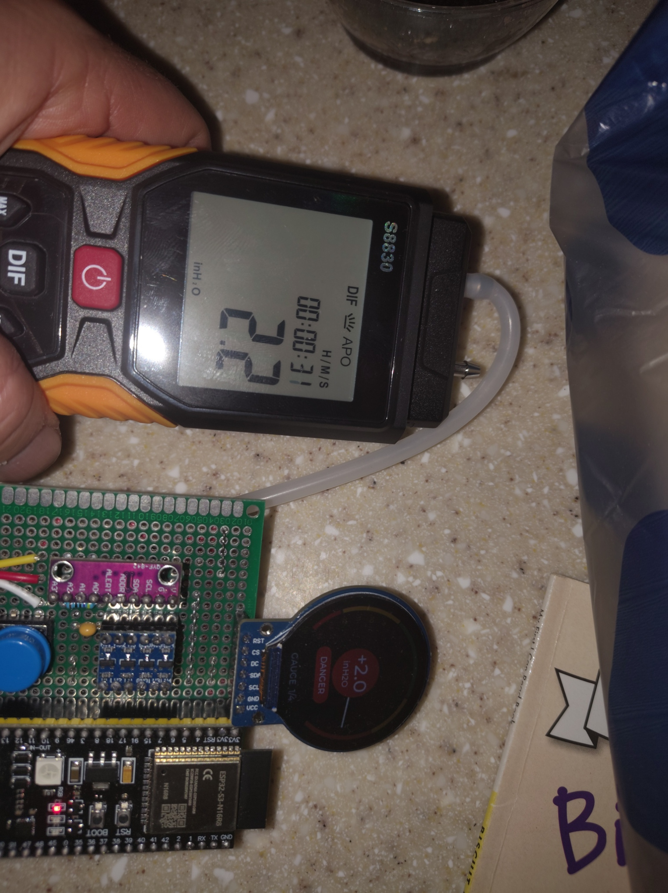
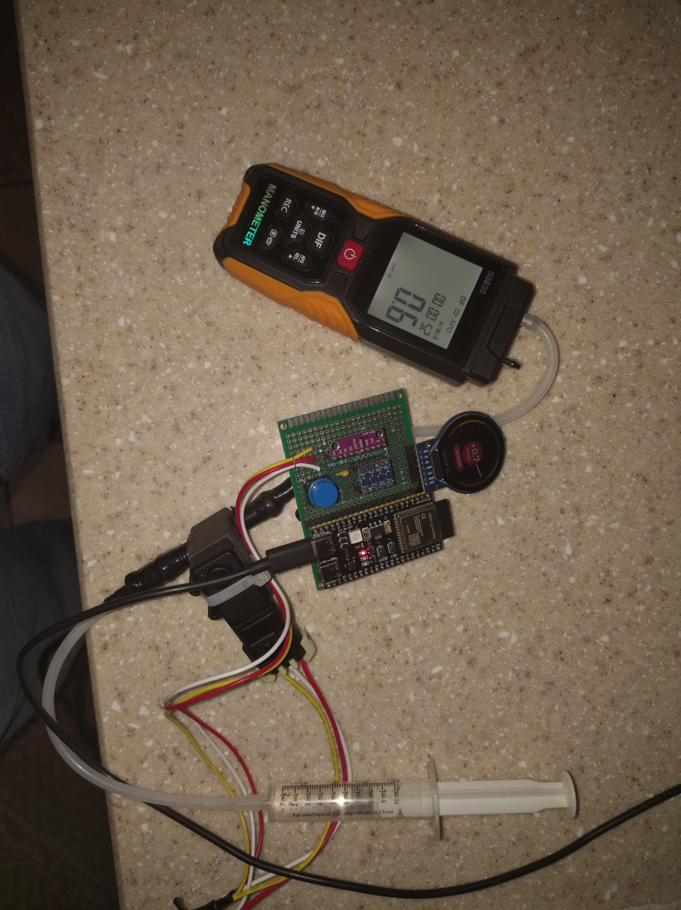
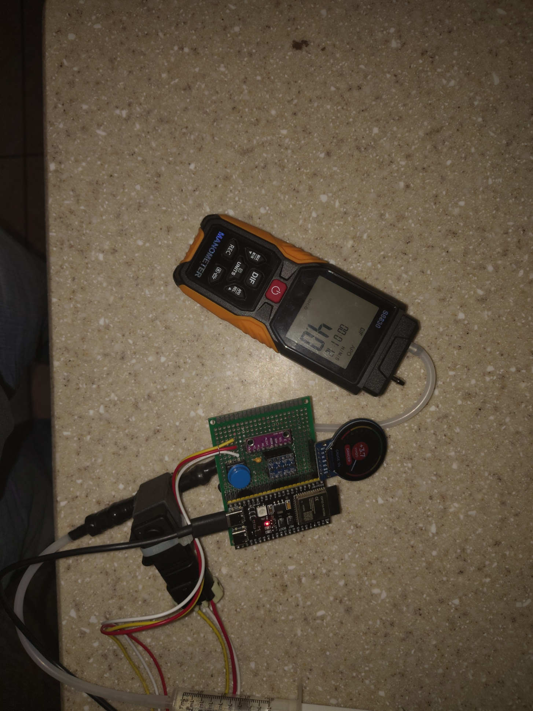
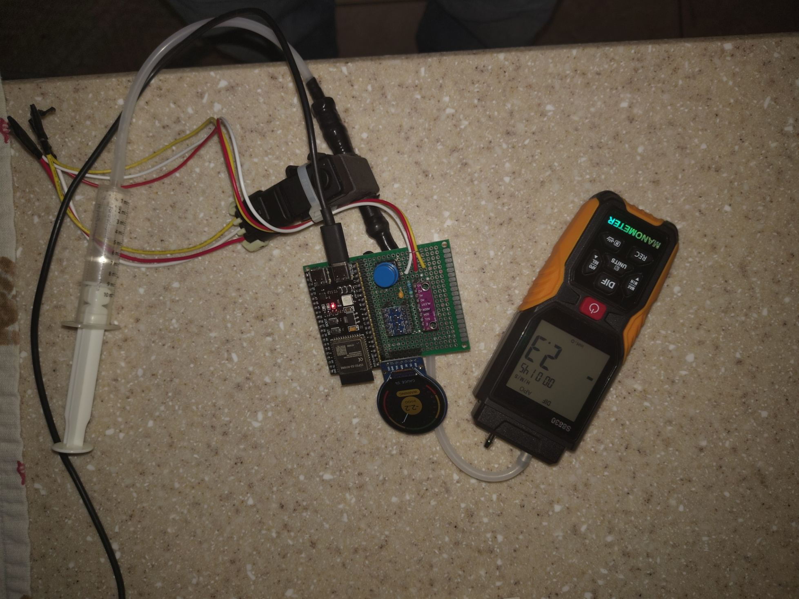

# FTP sensor and digital manometer comparison

**Test date:** 2026-11-10  
**Status:** Preliminary bench comparison; not a calibration record

This record documents a side-by-side comparison between the project gauge, which reads the installed GM-family fuel-tank-pressure (FTP) sensor through the ADS1115, and a generic S8830 digital differential manometer. The manometer was set to inches of water (`inH2O`) for this test. An earlier apparent tenfold mismatch was caused by the manometer being in a different unit; it disappeared after selecting `inH2O`.

## Setup and observations

The FTP sensor was installed in the project's pressure-tap tee. One manometer port was connected to the tee and a syringe applied pressure or vacuum through the other side. Soap-bubble solution was used to find a leak, which was repaired but remained a slow leak during these observations. The test was sufficient to sweep the displayed pressure from the negative to positive end of the observed range, but the source could not hold a steady pressure for a precision comparison.

The four photographs show these paired readings. Values are visually transcribed from the instrument displays; they were not captured as synchronized digital samples.

| Project gauge | S8830 manometer | Absolute difference | Direction |
|---:|---:|---:|---|
| +2.0 inH2O | +2.2 inH2O | 0.2 inH2O | Positive |
| +0.7 inH2O | +0.6 inH2O | 0.1 inH2O | Positive |
| +3.7 inH2O | +3.5 inH2O | 0.2 inH2O | Positive |
| −2.2 inH2O | −2.2 inH2O | 0.0 inH2O | Negative |

Across the broader manual sweep, the reported difference was approximately 0.1–0.3 inH2O, with the larger differences toward the more extreme readings. The photographs document only the points listed above; they do not document numerical values at the sweep endpoints.

## Interpretation and limits

The comparison supports correct pressure direction and a plausible scale for the current sensor-family conversion in the tested region. Correcting the manometer's unit selection explains the earlier apparent tenfold discrepancy; this evidence does not indicate a tenfold conversion error in the firmware.

This is not a calibration or accuracy validation. The S8830 is identified by its generic model label and the purchased listing (ASIN B0F59W4P1H), but its stated accuracy basis and traceability have not been established. The residual leak and hand-operated syringe also prevent steady, synchronized reference points. No raw ADC code or voltage was recorded alongside each photograph. Keep the existing sensor-family conversion as provisional until a controlled, repeatable test produces a comparison series with stable pressure, reference readings, and corresponding ADC data.

## Photographic record

The images show the bench arrangement and the four displayed readings. They are sanitized, orientation-corrected copies of the source photographs.

## Import provenance

The images came from the private staging batch `_staging/inbox/2026-manometer-comparison/`. Public JPEG copies were rotated according to their source orientation and re-encoded; embedded image metadata was removed. No visible personal information was identified in the photographs. The original staged files remain unchanged.
