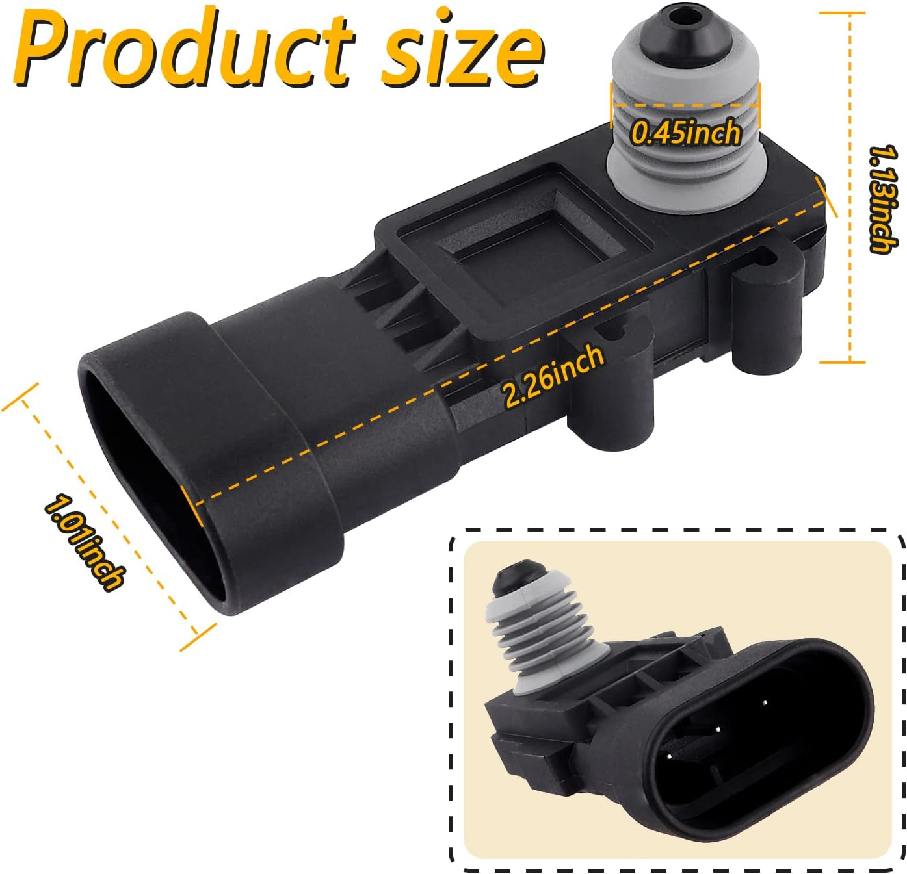
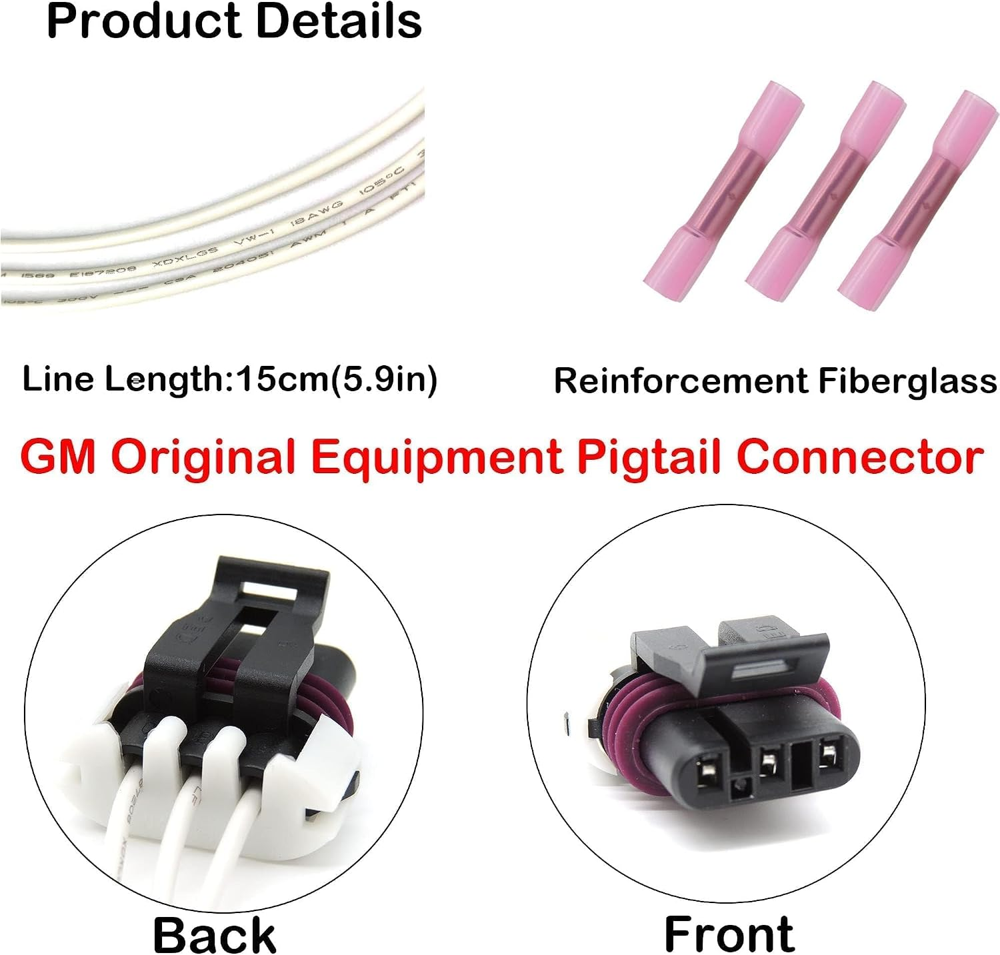

# Fuel-tank pressure sensor and pigtail

## From pressure to voltage

A **fuel-tank pressure (FTP) sensor** turns a pressure difference into an electrical signal. Its original role is fuel-system monitoring; this project uses the advertised low-range replacement family as a working basis for measuring small crankcase pressure changes. That reuse still needs calibration with the actual sensor.

The prototype treats it as a three-wire analog sensor: supply, ground reference and signal. **Analog** means pressure is represented by a changing voltage, rather than a digital message containing a pressure number. The ADS1115 measures the voltage; the ESP32 converts the resulting count into pressure using calibration. The pigtail provides the mating electrical connector and leads, not signal conversion. Exact cavity orientation and functions belong in [P04](../../pinouts/ftp-sensor.md).

The measurement is relative to atmosphere. Equalized pressure is defined as 0 inH2O; lower pressure is vacuum and is reported as negative. Zero pressure does not imply zero signal voltage: an analog sensor can have an offset at atmosphere. The actual pressure-reference/vent arrangement must be preserved in the installation described by [A04](../../architecture/pcv-system.md).

### Why calibration has more than one step

**Zero** establishes the output at atmospheric pressure. **Slope** describes how much the reading changes per unit of pressure. A zero adjustment alone cannot determine slope or correct all errors.

For a **hypothetical linear example**, suppose a complete chain produces 12,000 counts at atmosphere and 11,600 counts at a known -4 inH2O. Those points give `(-4 inH2O) / (-400 counts) = 0.01 inH2O/count`, so `pressure = (counts - 12,000) x 0.01`. This example does not specify the purchased sensor's direction, coefficients or limits. Additional pressure points and repeated readings test whether a linear fit describes the real chain.

Calibrate the sensor, ADC and chosen input circuit together using the [test plan](../../../docs/testing/test-plan.md). A precise voltage reading is useful, but pressure accuracy also depends on the sensor, reference, tubing and calibration. Keep liquid away from the sensing path and preserve the intended reference; those details are installation design work rather than conclusions from listing photos.

## Selected hardware

The planned gauge uses a GM 16238399-style low-range FTP sensor and a three-terminal pigtail. Supplied purchase details confirm the following items; compatibility and electrical behavior still require verification.

The [printed pressure-tap prototype](../../../cad/pressure-tap/README.md) provides a top sensor pocket and internal sensing passage; sensor seal/retention and post-anneal fit remain Q22.

See [A04: PCV system overview](../../architecture/pcv-system.md) for the proposed upstream pressure tap and sensor mounting questions, and [A01: overall gauge architecture](../../architecture/gauge-system.md) for the conditioned electrical measurement path.

See [P04: FTP sensor and pigtail interface](../../pinouts/ftp-sensor.md) for connector-view conventions, the sourced working terminal map and assembly checks.

## Purchase details

| Item | Purchased listing | Reported price |
| --- | --- | ---: |
| Aftermarket FTP sensor, listing cross-references 16196060 / 16238399 / 12219388 | [Amazon B0CNZ2Q1F2](https://www.amazon.com/dp/B0CNZ2Q1F2) | USD 7.89 |
| HiSport 13585316 fuel tank pressure sensor connector | [Amazon B09NVW46W2](https://www.amazon.com/dp/B09NVW46W2) | USD 7.99 |

The FTP sensor and pigtail are reported on hand. Purchased quantities and installation status remain unspecified. Prices are recorded as supplied, without assuming per-unit or pack pricing. The sensor listing's OEM-number references describe claimed compatibility, not proof of an OEM-manufactured sensor. PT2782 and PT2646 remain historical connector cross-references rather than separately purchased items.

## Supplied product references

Two product-listing images were supplied in batch `fuel-tank-pressure-sensor`, followed by the saved purchase details above. Images document appearance and advertised dimensions, not inspected hardware or a verified pinout.

### Sensor dimensions

The image labels overall length as 2.26 in, height as 1.13 in, connector-end width as 1.01 in, and a dimension across the pressure-port area as 0.45 in. The last callout does not establish an internal bore, thread specification, or required hose size. Confirm actual dimensions before designing an adapter or mount.

### Pigtail details

The image shows front and back views of a three-terminal connector, three light-colored wires, and three splice connectors. Advertised lead length is 15 cm (5.9 in). The visible original-equipment wording is a vendor claim; it does not verify manufacturer, authenticity, physical fit, or terminal assignments.

## Electrical and calibration status

The received sensor is reported to have no markings. Use the purchased listing's 16196060 / 16238399 / 12219388 replacement claim as the accepted working identity; missing markings are not a design blocker. Proceed as a nominal 5 V, three-wire analog FTP sensor, with relevant family documentation guiding the prototype. Revisit this assumption if connector fit, powered behavior or calibration contradicts it. This establishes a design basis, not OEM authenticity or a measured transfer curve.

[P04](../../pinouts/ftp-sensor.md) now adopts a GM service-document terminal map as the working reference: A ground, B signal and C 5 V, with the pigtail mating-face orientation defined there. W01 uses those IDs. Confirm lead continuity and fit during assembly; do not assign functions by wire color. A separate manufacturer identity investigation is not required without a discrepancy.

Use the nominal 5 V analog interface for conditioning design. Source additional output/pressure expectations from family documentation and label their application to this part as an assumption. Zero, slope and usable measurement range will be checked during normal calibration; those measurements need not precede circuit drafting. Product photographs alone provide no calibration equation or pressure limits.

### Published reference points for the advertised GM family

The 2002 Impala 3.4 L service description gives these output reference points for the GM 16238399 sensor listed for the 2002 Impala:

| Pressure relative to atmosphere | Published signal reference |
| ---: | ---: |
| `+4.5 inH2O` | `0.5 ± 0.2 V` |
| `0 inH2O` (atmospheric) | `1.3–1.7 V` |
| `−14 inH2O` | approximately `4.5 V` |

For this documented family, signal voltage falls as pressure becomes more positive and rises as vacuum increases. These are service-document reference points, not a guaranteed accuracy specification, full transfer curve, or documented clipping/saturation behavior. The service page does not establish behavior beyond the stated points. [2002 Impala FTP sensor service description](https://charm.li/Chevrolet/2002/Impala%20V6-3.4L%20VIN%20E/Repair%20and%20Diagnosis/Powertrain%20Management/Computers%20and%20Control%20Systems/Fuel%20Tank%20Pressure%20Sensor/Description%20and%20Operation/) and [GM parts catalog listing for 16238399](https://www.gmpartsgiant.com/parts-list/2002-chevrolet-impala/fuel_system_exhaust_emission_system/fuel_tank_filler_pipe.html).

The listing for the unmarked purchased sensor claims compatibility with several GM part numbers, including 16238399. That claim makes approximately `−14 to +4.5 inH2O` a useful **family-level working envelope for planning calibration**, but it does not validate that exact pressure span or transfer curve on the received aftermarket unit. Do not assume linearity between the published points without testing. Do not extend a pressure conversion beyond the actual calibrated domain, and do not treat voltage at an ADC rail as proof of a particular pressure.

Calibration must record its valid minimum and maximum pressure. Firmware should return an explicit out-of-range state outside those bounds, rather than extrapolating a numeric pressure. Sensor saturation, an out-of-calibration pressure, and an electrical/ADC fault are distinct conditions; the exact saturation voltage and pressure for this unit remain unknown until characterized. Use an `OUT OF RANGE` indication (optionally with a direction such as below/above calibrated range), not a fabricated endpoint value. A calibrated range may be narrower than the family reference envelope.

### Implications for gauge limits

The family reference envelope is an instrumentation constraint, not an engine-health threshold. The provisional hot-idle tuning target is approximately `−3 to −5 inH2O`, possibly extending toward `−8 inH2O`; this is a tuning objective, not a measured normal band. For a preliminary, configurable gauge policy after calibration, use `−8 to −3 inH2O` as a broad target band, warning bands outside it, and positive pressure (`>0 inH2O`) as a conservative danger candidate. A lower-danger candidate at `−12 inH2O` can exercise the low-side display while remaining inside the family reference envelope, but has no engine-specific evidence and must not be treated as a validated critical limit. These candidates must be reviewed against the actual calibration and repeatable idle/cruise/WOT baselines. Do not assign any numeric threshold beyond the calibrated domain; if a condition crosses a calibrated endpoint, report out-of-range rather than a pressure value or a more extreme alarm number. No production thresholds are established.

See the [firmware requirements](../../../firmware/README.md), [calibration/test plan](../../../docs/testing/test-plan.md), and [BOM](../../bom/parts.md).

## Import record - 2026-10-06

Imported `ftp-sensor.jpg` as `sensor-dimensions.jpg` and `pigtail.jpg` as `pigtail-details.jpg` under `media/reference/fuel-tank-pressure-sensor/`. These are third-party product illustrations, not project-created artwork or photographs of received hardware. Inbox originals remain unchanged.

Reviewed visible content for personal identifiers; none were observed. Removed JPEG application/comment metadata without recompression. Verified unchanged orientation, dimensions, and decoded pixels, and absence of personal metadata in public copies. No visual redactions, generative changes, physical fit checks, electrical tests, or calibration were performed. Purchase details were subsequently incorporated from the saved text file; the original remains in private staging.
