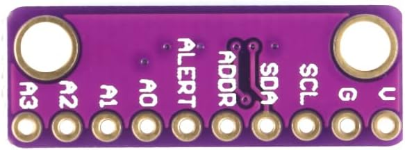

# P03: ADS1115 module interface

**Document state: Draft.** This page maps the purchased ADC module's vendor-image header to TI ADS1115 functions for the bench and finished-gauge designs. The purchase listing and BOM select ADS1115 as the working device; the shared PCB marking and vendor views do not establish every internal connection or measured behavior. Procurement and conditioning decisions belong in the [ADC component record](../components/adc/README.md).

## Identity and orientation

The [front image](../../media/reference/adc/adc-front.jpg) carries `GY-ADS1115/ADS1015`, a shared board marking. The purchased listing and BOM select ADS1115, so this interface uses its functions and specifications as the design basis. If normal bring-up behavior conflicts with ADS1115 expectations, investigate the module before interpreting pressure data; a bus response alone does not prove conversion format or timing.

View the **back as pictured above**, with the two mounting holes at the top and the single ten-position header row at the bottom. Read left to right: `A3 A2 A1 A0 ALERT ADDR SDA SCL G V`. The positions below are documentation coordinates, not manufacturer pin numbers. A front-side view reverses this order; match the printed labels before wiring. Header pitch, installed connector and mating orientation require physical confirmation.

## Header map

Directions are relative to the ADC. Header order/labels have **Vendor Listing** evidence from the back image; electrical functions have **Manufacturer Spec** evidence from TI section 4, conditional on the selected ADS1115 device and the pictured board routing. The shared 5 V supply and +/-6.144 V range are **Selected**; A0 wiring is planned. Physical operation remains for normal bring-up.

| Back-view position, left to right | Printed label | ADS1115 function (IC pin) | Direction | Project voltage domain / use |
| --- | --- | --- | --- | --- |
| 1 | A3 | AIN3 (7) | Analog input | GND to VDD; future channel, unused handling TBD |
| 2 | A2 | AIN2 (6) | Analog input | GND to VDD; future channel, unused handling TBD |
| 3 | A1 | AIN1 (5) | Analog input | GND to VDD; future channel, unused handling TBD |
| 4 | A0 | AIN0 (4) | Analog input | Conditioned pressure signal, proposed single-ended input relative to GND |
| 5 | ALERT | ALERT/RDY (2) | Open-drain output | Unused in W01; a future connection needs a documented pull-up/translation arrangement |
| 6 | ADDR | ADDR (1) | Digital input | Address selection; strap and existing board bias TBD |
| 7 | SDA | SDA (9) | Bidirectional, open-drain | I2C data on 5 V side of translator |
| 8 | SCL | SCL (10) | Digital input | I2C clock from translator, 5 V side |
| 9 | G | GND (3) | Power return / reference | Shared ADC, controller and conditioning reference |
| 10 | V | VDD (8) | Power input | Shared regulated 5 V sensor/ADC branch |

Parenthesized numbers are **TI IC package pins**, from the ADS1115 column of Table 4-1 for RUG, DYN and DGS packages. They are not breakout header numbers. Use the vendor-labeled header map for design and check orientation/continuity as part of assembly; investigate discrepancies if the circuit does not behave as expected. Sources: [vendor back image](../../media/reference/adc/adc-back.jpg) and [TI datasheet, section 4](../datasheets/ads1115-datasheet.pdf#page=3).

## Power, logic and analog boundary

The design supplies this module and the FTP sensor from the same regulated 5 V branch; see [A02](../architecture/power-system.md). TI specifies a 2.0-5.5 V IC supply. Check module connections and decoupling during assembly; TI specifies 100 nF at VDD to GND. Include ADC consumption in the 5 V load budget, not the controller's 3V3 peripheral budget.

SDA and SCL connect through a bidirectional I2C voltage translator: 5 V pull-ups on the ADC side and 3.3 V pull-ups on the ESP32 side. Account for fitted module and translator pull-ups before adding resistors. TI specifies VIH >= 0.7 x VDD (3.5 V with a 5 V supply), so 3.3 V pull-ups alone do not guarantee a valid high at this ADC supply. Do not connect the two bus domains directly. The [hiBCTR BSS138 translator](../components/i2c-level-shifter/README.md) is selected under Q28 without an enable GPIO; physical pull-up/bus/power checks remain Q29. ALERT is unused with polling; any future use requires its own compatible interface. Sources: [TI sections 4, 5 and 7](../datasheets/ads1115-datasheet.pdf).

Each analog input must stay between **GND and VDD in normal operation**, regardless of PGA range. GND - 0.3 V and VDD + 0.3 V are stress limits, not design headroom. Sharing regulated 5 V with the nominal 5 V sensor removes the need for divider scaling; the initial [470 ohm / 1 uF RC filter](../components/rc-input-filter/README.md) is selected separately and does not establish arbitrary fault tolerance. Keep sensor and ADC on the same branch without independently switching one during normal use. Assess local rail differences, startup/shutdown and retained filter charge under Q17. Sources: [TI sections 5.1 and 5.3](../datasheets/ads1115-datasheet.pdf#page=4).

Select **+/-6.144 V** to cover the assumed 0-5 V sensor signal without divider scaling. Actual input remains limited by VDD. At this range the nominal LSB is 187.5 uV; single-ended readings use the positive portion of the signed conversion range. This is code spacing, not pressure accuracy. Calibrated negative pressure comes from the atmospheric reference, not a negative A0 voltage. Sources: [TI section 7.3.3](../datasheets/ads1115-datasheet.pdf#page=15) and [A03](../architecture/measurement-system.md).

## I2C address and acquisition choices

TI defines these **7-bit** addresses; they are not shifted read/write address bytes:

| ADDR connection | Address |
| --- | --- |
| GND | `0x48` |
| VDD | `0x49` |
| SDA | `0x4A` |
| SCL | `0x4B` |

W01 selects ADDR-to-GND / `0x48` as the initial configuration candidate. The listing images do not establish whether the module includes an existing strap or bias; if the selected address does not respond, inspect the board connection and adjust the configuration. TI recommends using GND, VDD and SCL selections first; SDA selection has an additional timing requirement. See [TI section 7.5.1.1](../datasheets/ads1115-datasheet.pdf#page=20).

A0 single-ended pressure acquisition is proposed. The +/-6.144 V range is selected; data rate, mode, bus speed and polling remain bring-up candidates. The [component record](../components/adc/README.md#sampling-peaks-and-calibration) owns sampling goals and calibration requirements. Record configuration with measurements and verify fresh-conversion timing; a successful bus scan alone does not confirm the selected configuration or conversion performance.

[W01](../wiring/bench/README.md#adc-bring-up-candidate) now proposes N16R8 bus GPIOs, a GND address strap and an initial acquisition configuration with readiness polling. These are candidates pending module and circuit checks, not verified settings. W01 owns exact destinations; [P02: XIAO](xiao-esp32s3.md) still requires its own allocation. Optional ALERT use would add a GPIO requirement. This interface page does not assign harness connector identifiers.

## Bring-up and calibration checks

- [ ] With the selected single-source power arrangement, check safe 5 V/3.3 V rails and the translated bus before connecting the controller to the powered circuit.
- [ ] Verify communication at the W01 address and configuration, then compare ADC readings with safe measured voltages at A0. Inspect pull-ups, address wiring or continuity if these checks reveal unexpected behavior.
- [ ] Record the configuration used for calibration and verify fresh-conversion timing; update acquisition settings if measured behavior requires it.
- [ ] Validate the ADC-node voltage across the sensor's intended range and calibrate the complete sensor/conditioning/ADC chain before interpreting pressure.

For the initial code/voltage comparison, use the diagnostic-only [`n16r8_adc` firmware target](../../firmware/src/measurement/README.md#phase-3-voltage-acquisition-bench-build). It reports calculated A0 voltage and raw conversion code; compare it with a multimeter at the same node. Physical rail, bus, and voltage tracking results remain unrecorded until this bring-up is performed.

## Source reference

Electrical functions above use the preserved [TI ADS111x datasheet](../datasheets/ads1115-datasheet.pdf), **SBAS444E, December 2024**. Its [provenance and checksum](../datasheets/README.md) identify the local revision. Header evidence is the supplied vendor imagery preserved in the [component record](../components/adc/README.md#supplied-board-references); it does not establish the received board's schematic or tested behavior.
