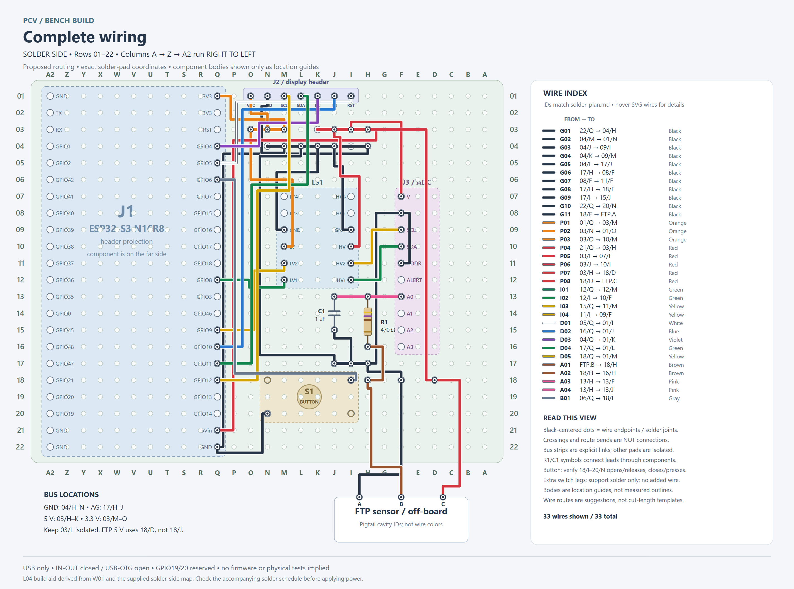

# L04: solder-side protoboard wiring layout

L04 translates [W01's electrical connections](../README.md) into a solder plan for the reported 27-column by 22-row carrier. It shows where module terminals meet the board, where to place the filter and button, and how to route colored wires between the solder pads. Start with the [illustrated solder plan](solder-plan.md) and [coordinate map](coordinate-map.md).

**Document state: Draft; connectivity and rendering reviewed.** Module coordinates are reported physical positions. Bus strips, R1/C1, button placement and routing are proposals, not a completed or electrically tested assembly. Check the button contact pair and actual package clearance during assembly. Firmware and measured operation remain pending.

## Views and orientation

All coordinates use the **printed solder-side labels**: A at the right, A2 (the repeated A after Z) at the left, row 01 at the display/antenna end and row 22 toward USB. The component-side printing differs. J1.L identifiers retain the front-view naming from P01, so the selected ESP32 header is column Q in this solder-side view.



| View | Vector drawing | PNG preview |
| --- | --- | --- |
| Complete wiring, 33 wires | [SVG](generated/board-overview.svg) | [PNG](generated/board-overview.png) |
| Ground and power | [SVG](generated/board-ground-power.svg) | [PNG](generated/board-ground-power.png) |
| I2C and display signals | [SVG](generated/board-digital.svg) | [PNG](generated/board-digital.png) |
| Sensor, filter and button, with related supplies/returns | [SVG](generated/board-sensor-button.svg) | [PNG](generated/board-sensor-button.png) |

Hover wires in a browser-opened SVG for terminal names, coordinates and functions. PNGs are 2850 x 2115 pixels. The illustrated solder plan embeds each sectional image beside its relevant instructions.

Endpoint dots and explicit bus strips identify solder joints. Other crossings and bends are insulated routing, not connections. R1/C1 symbols connect leads through components, not copper shorts. Body outlines are location guides rather than measured footprints. The rendered paths do not prescribe wire lengths or establish physical clearances.

The FTP sensor remains off-board. Its 5 V landing pad is 18/D; the earlier private proposal's 18/J position was superseded to clear the on-board button. Button legs occupy 18/I, 18/N, 20/I and 20/N. Wiring 18/I to GPIO6 and 20/N to ground is conditional on those contacts being open when released and closed when pressed. The two remaining legs have no added wires; their internal connectivity is not inferred by the software checks.

## Source responsibilities

- [W01 YAML](../bench-harness.yml) owns electrical connections and colors. The L04 buses/landing pads subdivide those nets without creating a competing circuit design.
- [generate-plan.py](generate-plan.py) owns L04 physical terminal coordinates, proposed placements and the wire schedule. It generates `solder-plan.md` and `coordinate-map.md` and checks their nets/colors against W01.
- [render-board.py](render-board.py) owns suggested route bends and styling, deriving wire endpoints from the plan. It generates the four SVGs.
- [export-png.mjs](export-png.mjs) rasterizes local SVGs and records SHA-256 fingerprints in [png-generation.json](generated/png-generation.json).
- [check-layout.py](check-layout.py) checks current sources against committed documents/SVGs, route-to-pad separation and PNG provenance without modifying files. The repository validator runs it automatically.

Change source data and regenerate; do not patch only a rendered diagram or generated table. A same-net routing refinement need not change W01, but an actual electrical change must begin there. Record physical findings separately before promoting proposed positions or working pinout assumptions to measured evidence.

## Reproduce and check

Python uses the existing [W01 requirements](../requirements.txt), including PyYAML; no new Python dependency is needed. SVG generation does not require Graphviz, a browser or network access. With that environment active, run from the repository root:

```powershell
python hardware/wiring/bench/protoboard/render-board.py
```

PNG export is optional tooling for maintainers who change the drawings. Use Node.js and Puppeteer 25.12.0 in an ignored local tools folder. One way to install it is:

```powershell
npm install --prefix _staging/work/l04/tools --no-save puppeteer@25.12.0
node hardware/wiring/bench/protoboard/export-png.mjs _staging/work/l04/tools
```

Puppeteer installation needs network access and downloads its browser. Export itself uses a headless local Chromium page with network requests blocked; nothing is uploaded and no simulation or firmware is run. An existing compatible tools installation can be passed instead. Do not commit its dependencies, browser cache or local environment.

After export, inspect all four PNGs and run:

```powershell
python hardware/wiring/bench/protoboard/check-layout.py
python tools/check-repository.py
```

Validation covers unique occupied coordinates and grid bounds, all non-USB W01 nets/colors, RC copper topology, SVG wire coverage, freshness of generated documents/SVGs, image fingerprints and local links. Routes must clear unrelated occupied pad centers by at least 9 SVG units: a legibility check, not a physical clearance rating. These checks do not establish package fit, button contact pairing, rail behavior, firmware operation or calibration.

Rendering was exercised with Python 3.12, Node 24 and Puppeteer 25.12. Runtime versions and source/output hashes accompany the PNGs. Review visual changes alongside source changes; fingerprints alone cannot establish a good drawing.

## Relationship to other views

[L01](../../../../simulation/wokwi/README.md) remains the functional component-and-wire illustration. [L03](../../../../simulation/wokwi/breadboard/README.md) remains a temporary breadboard illustration with explicit virtual strip connections. L04 is the coordinate-based soldering reference for this carrier. Wokwi can support interactive illustrations and future firmware simulation; it is not required to reproduce L04. The [general protoboard plan](../protoboard-plan.md) retains construction, gauge and retention guidance.

## Import provenance

Imported 2026-10-13 from private batch `2026-10-12-board`: reviewed generated plans, original drawing scripts, reported solder-side terminal coordinates and button lead spacing. The two supplied component-side photographs informed module identification and placement context; they are not republished. No measurement, completed soldering or electrical test is inferred from them.

Public copies replace private output paths and working-document names with repository-relative paths, add non-mutating validation and regeneration records, and regenerate SVG/PNG outputs. Reviewed source text, links, drawing content and generated image metadata for personal/sensitive information; personal filesystem paths and photographic metadata are not included. Staging originals are preserved. These are generated engineering drawings, not altered photographic evidence.
