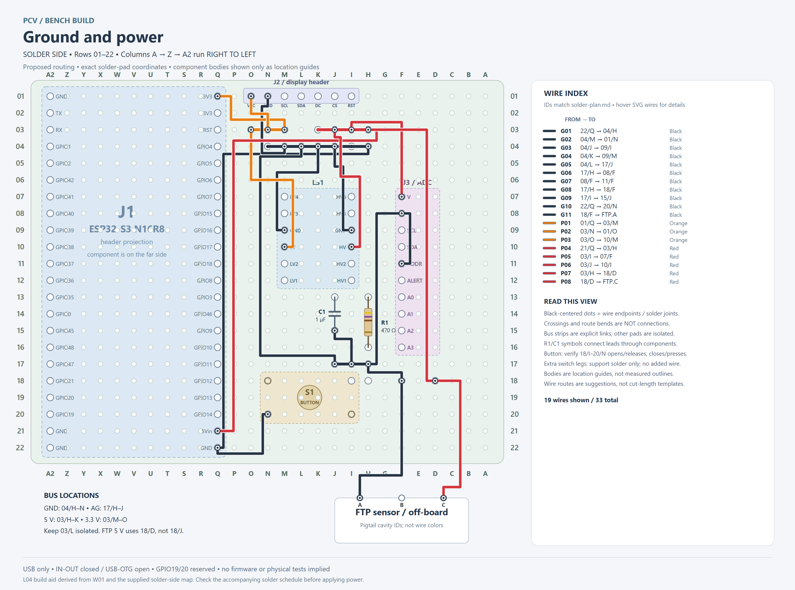
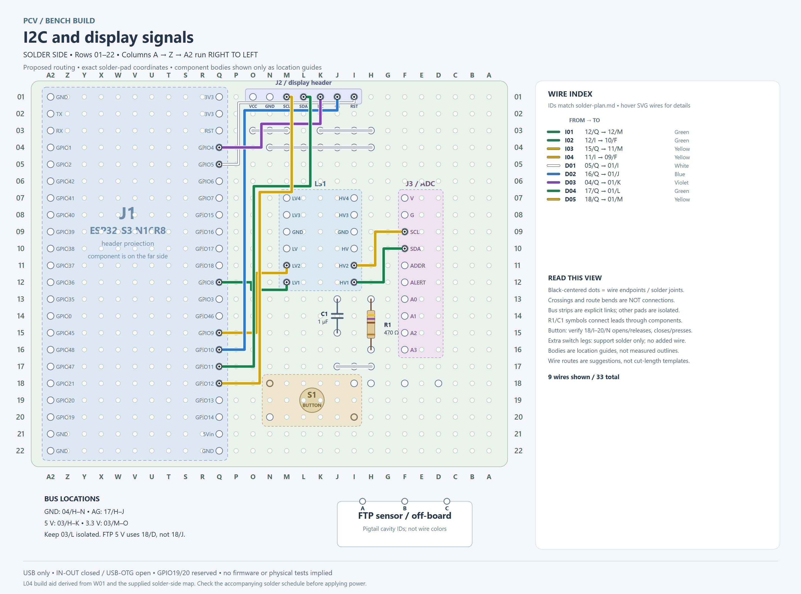
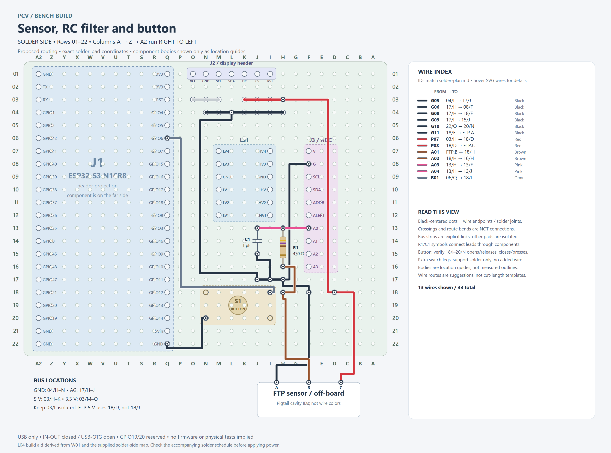

# Solder-side bench wiring plan

**Use the printed solder-side coordinates for every hole in this document.** The corrected map supplied on 2026-10-13 supersedes the earlier mixed-face coordinates. Rows run 01-22 from the display/antenna end toward the USB end. Column **A2** means the repeated A after Z; it is the ESP32's other header, not the first A. Do not translate these letters using the component-side printing.

J1.L names retain the project’s component-front-view header naming even while soldering from the back. Thus J1.L1 is the 3V3 pin at **01/Q**, J1.L21 is 5Vin at **21/Q**, and J1.L22 is GND at **22/Q**. The other ESP32 header is column A2. All selected gauge wires use column Q.

Existing module coordinates are supplied physical locations. New bus, RC and cable-landing locations below are **proposed placements**, not claims that they are already fitted. Pads are individually isolated. The schedule preserves W01 electrical nets, GPIOs and colors. It is a bench construction plan; physical operation and firmware remain untested.

## Complete wiring overview

[Open zoomable SVG](generated/board-overview.svg). The sectional images below show the same routing with other circuits omitted. Crossings are insulated; only designated endpoints and bus strips are joined. Physical bend locations are suggestions, not a cut-length template.

### Routing audit changes

Three wire starts were optimized without changing electrical nets: **G02 now starts at ground tap 04/M (was 04/I)**; **G10 now starts at ESP32 GND 22/Q (was ground tap 04/N)**; **P07 now starts at 5 V tap 03/H (was 03/K)**. All destination pins, GPIOs, component placements and bus strips remain as listed. If earlier wiring is already installed, those former same-net starts remain electrically valid; rerouting them is optional.

G01 and G10 share the controller's 22/Q ground solder node. P04 and P07 share the 03/H 5 V bus tap. Make a supported solder junction at each, without forcing multiple wires through a single hole. Shorter suggested bends also simplify the I2C and button signal routes.

## Parts and placement

| Part | Value / options | First lead, solder-side row / column | Second lead, solder-side row / column |
| --- | --- | --- | --- |
| R1 | 470 ohm, 1/4 W axial; 1% metal-film preferred, 5% carbon-film acceptable; 1/8 W also sufficient for normal signal use | IN: **16/H** | OUT: **13/H** |
| C1 | 1 uF nonpolar film **or X7R ceramic**, rated at least 10 V; 16/25/50 V also fine | Signal: **13/J** | Ground: **15/J** |

Fit the bodies on the component side and solder their leads at those solder-side hole labels. R1 spans three 2.54 mm intervals (7.62 mm); C1 spans two (5.08 mm). Bend leads gently to suit, leaving clearance at the body. Neither selected part is polarized. A bulky film capacitor can stand above the board on supported/insulated leads; do not force a package into this footprint or let its leads touch adjacent pads. If a particular stock part cannot fit, relocate its holes in this plan before soldering; its value and circuit need not change.

470 ohm examples: four bands yellow-violet-brown-gold (5%), or five bands yellow-violet-black-black-brown (1%). Verify with the meter before fitting. A capacitor marked **105** is nominally 1 uF, but that code does not establish its voltage rating or dielectric. Use packaging/part information for those. Do not substitute a polarized electrolytic/tantalum for the selected nonpolar C1.

R1 is the only connection between IN and OUT. C1 is the only component between its signal lead and ground. **Do not install a jumper across either component.** C1 is a signal filter, not the ADC's supply bypass capacitor. The ADC's +/-6.144 V gain setting does not permit an A0 voltage outside its ground-to-supply range.

### On-board button placement

The reported footprint has four empty holes between legs in one direction and one empty hole in the other: five and two grid intervals, nominally **12.7 mm x 5.08 mm** on this carrier. Mount the button on the component side with its leads through solder-side holes **18/I, 18/N, 20/I and 20/N**. Dry-fit the body before soldering; the footprint does not establish the casing dimensions. Keep its casing clear of R1/C1 and insulate any nearby exposed metal. Bus spines and sensor wire joints in this area belong on the solder side, not under the button body on top.

Use **18/I for signal** and **20/N for ground**, conditional on the unpowered contact check in section 6. Solder the other legs into their isolated pads for support with no added wires. No external button cable or separate button landing pads are needed; former 20/M and 20/O landing pads are released. G12 and B02 from the earlier off-board schedule are retired; the other circuit IDs stay stable.

**Placement revision:** move the proposed FTP-5V landing pad from **18/J to 18/D** to keep the supply termination outside the button footprint. Both red wires P07/P08 now use 18/D. The old 18/J pad stays unconnected. If wires were already fitted there, disconnect power and relocate both before fitting the button. FTP-GND remains 18/F and FTP-SIG remains 18/H; route and support these leads on the solder side with clearance from switch legs.

## Build these short distribution buses first

These are new copper links you add, not existing board traces. Join every adjacent pair specified below. Prefer a solid wire spine tacked to each pad, with stripped tap ends soldered to the spine; do not rely on a long unsupported solder blob. Insulate crossings and exposed wire outside the intended bus. More than one lead may join a node at the solder side without forcing several conductors through one hole.

| Bus | Explicit pad-to-pad links, all solder-side | Color | Purpose |
| --- | --- | --- | --- |
| G / main ground | 04/H–04/I; 04/I–04/J; 04/J–04/K; 04/K–04/L; 04/L–04/M; 04/M–04/N | Black | Main return distribution |
| P5 / nominal 5 V | 03/H–03/I; 03/I–03/J; 03/J–03/K | Red | Shared sensor/ADC/translator HV supply |
| P3 / 3.3 V | 03/M–03/N; 03/N–03/O | Orange | Display and translator LV supply |
| AG / analog ground | 17/H–17/I; 17/I–17/J | Black | Local ADC/filter/sensor returns |

**Leave 03/L unconnected** between the two supply buses. Do not join row 03 to row 04. AG is the same electrical ground as G, connected by G05 below. Ground taps 04/I and 04/N and the 5 V tap 03/K have no outgoing wires in the optimized schedule; retain their bus links as specified.

## Off-board connection landing pads

| Label | Solder-side row / column | Added lead color | External endpoint |
| --- | --- | --- | --- |
| FTP-GND | 18/F | Black | FTP pigtail A |
| FTP-SIG | 18/H | Brown | FTP pigtail B |
| FTP-5V | 18/D | Red | FTP pigtail C |

The **FTP sensor stays off-board**. These are separate landing pads, not an assumed standard connector pin order. Leave the intervening holes isolated. Support/strain-relieve the cable before its solder joints; use secure removable connections if convenient. The button is on-board at the four holes specified above.

At the FTP pigtail **mating face**, looking into its terminal openings with latch up: A is left/ground, B center/signal, C right/5 V, per the adopted family map. The wire-entry view reverses left/right. Trace cavities to the free leads with the disconnected pigtail and label them. Listed wire colors apply to added wiring, not factory pigtail insulation.

## Wire schedule

Every row is one wire. Bus-spine links are separately listed above. R1/C1 are installed parts, not omitted jumper wires. Use insulated 22 AWG as a practical starting choice for main feeds and display power, 24 AWG for short signal/module leads, subject to pad fit and actual load. Cut to fit with modest service slack. Record and label any color substitutions.

### 1. Common ground and address — black

Ground gives all modules the same zero-volt reference and a return path. The separate AG bus joins sensor, ADC and capacitor returns locally; it is wired to the main ground bus, not isolated from it. The display has its own return to the main bus. Build the ground and AG bus links listed above first.

[Open zoomable SVG](generated/board-ground-power.svg). This view covers ground and supplies in sections 1–2.

| Circuit | Start component pin / node | Start row / column | Wire color | End component pin / node | End row / column | Function |
| --- | --- | --- | --- | --- | --- | --- |
| G01 | ESP32 GND (J1.L22) | 22 / Q | Black | Ground bus tap | 04 / H | Main carrier return to controller/USB ground |
| G02 | Ground bus tap | 04 / M | Black | Display GND | 01 / N | Display power return from the nearest available main-ground tap |
| G03 | Ground bus tap | 04 / J | Black | Translator GND_HV | 09 / I | Translator high-side ground pad |
| G04 | Ground bus tap | 04 / K | Black | Translator GND_LV | 09 / M | Translator low-side ground pad; same ground net |
| G05 | Ground bus tap | 04 / L | Black | Analog ground bus tap | 17 / J | Connect local analog return to main ground |
| G06 | Analog ground bus tap | 17 / H | Black | ADC G | 08 / F | ADC supply return and analog reference |
| G07 | ADC G | 08 / F | Black | ADC ADDR | 11 / F | Select candidate I2C address 0x48; check for contradictory existing hard strap |
| G08 | Analog ground bus tap | 17 / H | Black | FTP-GND landing pad | 18 / F | Sensor ground landing pad |
| G09 | Analog ground bus tap | 17 / I | Black | C1 ground-side lead | 15 / J | Short local filter-capacitor return |
| G10 | ESP32 GND (J1.L22) | 22 / Q | Black | Button ground leg (check switched pair) | 20 / N | Short button return directly to controller ground; same common-ground net |
| G11 | FTP-GND landing pad | 18 / F | Black | FTP pigtail A / ground | Off-board | Off-board sensor low-reference lead |

### 2. Supplies — orange 3.3 V, red nominal 5 V

The controller's regulator supplies 3.3 V to the display and translator LV reference. Its USB-fed 5Vin pin supplies the ADC, sensor and translator HV reference. The translator does not generate either voltage. Build the two separate supply buses first; row 03/L stays isolated between them.

| Circuit | Start component pin / node | Start row / column | Wire color | End component pin / node | End row / column | Function |
| --- | --- | --- | --- | --- | --- | --- |
| P01 | ESP32 3V3 (J1.L1) | 01 / Q | Orange | 3.3 V bus tap | 03 / M | Controller-regulated 3.3 V distribution |
| P02 | 3.3 V bus tap | 03 / N | Orange | Display VCC | 01 / O | Display supply at selected 3.3 V |
| P03 | 3.3 V bus tap | 03 / O | Orange | Translator LV | 10 / M | Translator low-side voltage reference |
| P04 | ESP32 5Vin (J1.L21) | 21 / Q | Red | Nominal 5 V bus tap | 03 / H | USB-derived nominal 5 V distribution; requires IN-OUT closed |
| P05 | Nominal 5 V bus tap | 03 / I | Red | ADC V | 07 / F | ADC supply for full sensor voltage range |
| P06 | Nominal 5 V bus tap | 03 / J | Red | Translator HV | 10 / I | Translator high-side voltage reference |
| P07 | Nominal 5 V bus tap | 03 / H | Red | FTP-5V landing pad | 18 / D | Sensor supply landing pad from the nearer end of the shared 5 V bus |
| P08 | FTP-5V landing pad | 18 / D | Red | FTP pigtail C / 5 V | Off-board | Off-board sensor supply |

### 3. ADC I2C — green data, yellow clock

I2C carries configuration commands and ADC readings. Channel 1 translates SDA data; channel 2 translates SCL clock. Devices pull the bus low or release it, while pull-ups establish different high voltages on the two sides. Do not directly bridge LV1-HV1 or LV2-HV2; the module performs that translation. No additional pull-ups are specified beyond fitted module resistors.

[Open zoomable SVG](generated/board-digital.svg). This view covers I2C and display connections in sections 3–4.

| Circuit | Start component pin / node | Start row / column | Wire color | End component pin / node | End row / column | Function |
| --- | --- | --- | --- | --- | --- | --- |
| I01 | ESP32 GPIO8 (J1.L12) | 12 / Q | Green | Translator LV1 | 12 / M | 3.3 V controller-side I2C data / GPIO8 |
| I02 | Translator HV1 | 12 / I | Green | ADC SDA | 10 / F | 5 V ADC-side I2C data |
| I03 | ESP32 GPIO9 (J1.L15) | 15 / Q | Yellow | Translator LV2 | 11 / M | 3.3 V controller-side I2C clock / GPIO9 |
| I04 | Translator HV2 | 11 / I | Yellow | ADC SCL | 09 / F | 5 V ADC-side I2C clock |

### 4. Display SPI and controls

The display's SDA/SCL labels mean SPI data and clock here, not I2C. These five signals connect directly to ESP32 3.3 V GPIOs, without the translator. Label the green/yellow pair DISPLAY to distinguish it from ADC I2C. There is no additional MISO or backlight wire.

| Circuit | Start component pin / node | Start row / column | Wire color | End component pin / node | End row / column | Function |
| --- | --- | --- | --- | --- | --- | --- |
| D01 | ESP32 GPIO5 (J1.L5) | 05 / Q | White | Display RST | 01 / I | GPIO5 resets the display; not the ESP32 RST pin |
| D02 | ESP32 GPIO10 (J1.L16) | 16 / Q | Blue | Display CS | 01 / J | GPIO10 selects the display during transfer |
| D03 | ESP32 GPIO4 (J1.L4) | 04 / Q | Violet | Display DC | 01 / K | GPIO4 distinguishes command bytes from display data |
| D04 | ESP32 GPIO11 (J1.L17) | 17 / Q | Green | Display SDA | 01 / L | GPIO11 sends SPI commands/pixels (MOSI) |
| D05 | ESP32 GPIO12 (J1.L18) | 18 / Q | Yellow | Display SCL | 01 / M | GPIO12 clocks SPI transfers |

### 5. Pressure signal and RC filter

The 470 ohm resistor is in series with the sensor output. The 1 uF capacitor runs from the resistor's ADC end to ground. This low-pass filter reduces rapid voltage noise; it does not divide the signal voltage. Its nominal ideal time constant is 0.47 ms and cutoff about 339 Hz, not a measured system response. Keep these pink wires short and away from the display clock group where practical.

[Open zoomable SVG](generated/board-sensor-button.svg). This view covers the sensor/filter and button in sections 5–6, with their related supply/return wires.

| Circuit | Start component pin / node | Start row / column | Wire color | End component pin / node | End row / column | Function |
| --- | --- | --- | --- | --- | --- | --- |
| A01 | FTP pigtail B / signal | Off-board | Brown | FTP-SIG landing pad | 18 / H | Off-board raw sensor signal; identify factory lead by cavity |
| A02 | FTP-SIG landing pad | 18 / H | Brown | R1 sensor-side lead | 16 / H | Connect raw signal to input end of resistor |
| A03 | R1 ADC-side lead | 13 / H | Pink | ADC A0 | 13 / F | Short filtered signal connection to ADC A0 |
| A04 | R1 ADC-side lead | 13 / H | Pink | C1 signal-side lead | 13 / J | Join capacitor signal lead to the same filtered node |

### 6. Multifunction button

The on-board normally-open button connects GPIO6 to ground when pressed. Firmware will enable its internal pull-up and interpret gestures; neither is implemented yet. The selected diagonal legs 18/I and 20/N must be open when released and connected when pressed: check the loose switch before wiring. If they are already connected, do not fit this pair's wires; identify the actual switched pair and update its coordinates first. The other two legs receive solder for support but no added wire; they may still be internally connected to the used contacts. G10 supplies the ground wire.

| Circuit | Start component pin / node | Start row / column | Wire color | End component pin / node | End row / column | Function |
| --- | --- | --- | --- | --- | --- | --- |
| B01 | ESP32 GPIO6 (J1.L6) | 06 / Q | Gray | Button signal leg (check switched pair) | 18 / I | GPIO6 directly to on-board button signal contact |

## Power jumper and checks

1. Solder and check with all power unplugged. Complete the mechanical wiring in the order above; no firmware is needed to build it. Removable modules can be taken out for socket soldering and bare-carrier short checks.
2. The selected ESP32 power setup requires **IN-OUT closed, USB-OTG open**. Close only the labeled IN-OUT pads if needed; do not bridge other jumpers. These are on the ESP32 module, not carrier holes. Use native USB (left port in the original component-front photo); its apparent side reverses when viewed from behind. COM remains disconnected. One computer or standalone USB source at a time; no simultaneous external 5 V injection.
3. Inspect continuity along every intended wire and bus; check adjacent pads for unintended bridges. Check no copper short between 3.3 V, nominal 5 V, ground, raw signal and filtered signal. R1 IN-to-OUT should be about 470 ohm with parallel circuitry isolated. C1 can produce a transient charging indication; it must not be bypassed by a sustained copper short. Meter readings through fitted modules need interpretation.
4. With peripherals disconnected/removed, power the controller and measure 3V3 and 5Vin against ground. The selected family circuit has a USB input diode; nominal 5 V is not necessarily 5.000 V. Disconnect power before installing modules. Then check actual rail voltage/load with peripherals, including sensor and ADC supply at their endpoints.
5. Before communication, verify the translator LV/HV supplies and respective idle bus levels. Start with the fitted pull-ups; communication at the proposed 100 kHz requires firmware. Keep sensor and ADC powered from the same branch; no independently powered sensor feeding an unpowered ADC is selected.
6. Leave ADC ALERT and A1/A2/A3 externally unconnected for this A0-only build. Leave translator channels 3/4 externally unconnected. Do not add gauge wiring to ESP32 GPIO19/20 (native USB) or GPIO35/36/37 (N16R8 memory use). The second 3V3 and other unused headers need no extra wires.
7. Display output, button gestures and ADC readings require firmware that has not yet been implemented. Continuity and voltage checks validate only those measured aspects, not calibration or complete operation.

Route insulated wires on the solder side without obstructing sockets or USB access. Use the open gap between modules for the translated I2C connections. Run the display group toward the top; keep the short pink filter wiring local. A crossing is not an electrical junction unless explicitly soldered. Preserve module removal and support the protruding display/controller mechanically.

## Evidence and maintenance

- [Full component coordinate map](coordinate-map.md): supplied solder-side positions plus proposed new parts/pads.
- [W01 source](../../../../hardware/wiring/bench/bench-harness.yml) and [connection schedule](../../../../hardware/wiring/bench/generated/connections.md): connectivity and color authority. The buses and landing pads subdivide its connections without changing their electrical nets.
- [Controller power plan](../../../../hardware/components/esp32-s3-dev-board/power-plan.md), [ADC pinout](../../../../hardware/pinouts/ads1115.md), [display pinout](../../../../hardware/pinouts/gc9a01.md), [translator](../../../../hardware/components/i2c-level-shifter/README.md), [FTP pinout](../../../../hardware/pinouts/ftp-sensor.md), [RC filter](../../../../hardware/components/rc-input-filter/README.md).
- Published references rechecked during preparation: [TI ADS1115](https://www.ti.com/lit/ds/symlink/ads1115.pdf), [board designer](https://github.com/vcc-gnd/YD-ESP32-S3), [Espressif GPIO restrictions](https://docs.espressif.com/projects/esp-idf/en/stable/esp32s3/api-reference/peripherals/gpio.html), [Philips translation explanation](https://cdn-shop.adafruit.com/datasheets/an97055.pdf), [purchased display listing](https://www.amazon.com/dp/B0DYP4J9XP), and [purchased translator listing](https://www.amazon.com/dp/B0DSZBC8K6). Exact purchased carrier circuitry remains the documented family assumption.

The generator `generate-plan.py` produces both Markdown files and checks occupied-pad uniqueness, board bounds, wire colors and electrical-net equivalence against all non-USB W01 connections. R1/C1 topology is checked separately; they are not treated as copper shorts. Run `render-board.py` and `export-png.mjs` after changing this plan; see [reproduction instructions](README.md#reproduce-and-check). These are document checks, not physical fit or electrical tests. Reported module coordinates and proposed placements have separate evidence states; see [provenance](README.md#import-provenance).
