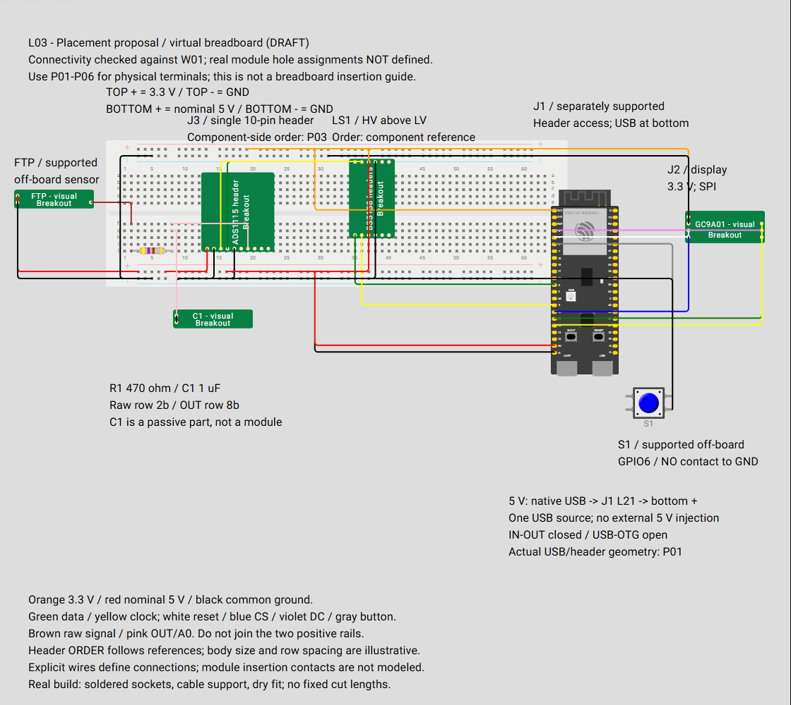

# L03: breadboard placement and jumper routing

**Draft assembly-planning view.** [diagram.json](diagram.json) groups the ADC/filter and level shifter around a native Wokwi full-size solderless breadboard. The controller has separate support to the right, leaving its headers and bottom USB ports accessible. The sensor enters from the left, display sits to the right, and button has its own supported space below. Dedicated rail taps replace L01's floating distribution symbol.



Open the [full PNG](diagram-preview.png) to zoom. [L01](../README.md) remains the functional overview; [W01](../../../hardware/wiring/bench/README.md) remains the electrical connection authority. The [protoboard plan](../../../hardware/wiring/bench/protoboard-plan.md) explains permanent sockets, support, wire gauges and strain relief.

**Real module hole assignments are not defined.** The checker establishes equivalence of explicit wires and named virtual strips/rails to W01. It does not account for contacts implied by inserting actual module headers, certify clearance or validate the real board's footprint. Do not solder sockets or insert modules using the image's apparent hole positions.

## What the carrier represents

Wokwi's [supported hardware](https://docs.wokwi.com/getting-started/supported-hardware) lists standard, half and mini solderless breadboards. This view uses the native `wokwi-breadboard`; no native perfboard was established by this review. The real bench still uses the selected solderable protoboard. Its pad connections may differ from this breadboard, so create the equivalent soldered nodes rather than assuming identical internal connections.

The board makes distribution and signal strips visible. Layout-specific ADC and translator symbols now reproduce the **documented header order**, with arbitrary body dimensions and row separation. The capacitor and display remain generic, and the native virtual controller differs from the YD-style board. A symbol appearing over a hole does not establish a connection: explicit wires and documented breadboard groups define this view. Permanent construction retains soldered sockets rather than loose breadboard contacts.

### Header arrangements and orientation

Read these orders from the component side, left to right in the illustrated orientation:

| Part | Header arrangement / order | Source |
| --- | --- | --- |
| J3 | One ten-position row: V, G, SCL, SDA, ADDR, ALERT, A0, A1, A2, A3 | [P03 ADS1115](../../../hardware/pinouts/ads1115.md) |
| LS1 upper | HV1, HV2, HV, GND_HV, HV3, HV4 | [Level-shifter reference](../../../hardware/components/i2c-level-shifter/README.md) |
| LS1 lower | LV1, LV2, LV, GND_LV, LV3, LV4 | Same reference; two parallel six-position rows |
| J1 | Native DevKitC symbol remains a functional substitute; use the purchased board's two 22-position rows | [P01 controller](../../../hardware/pinouts/esp32-s3-devkit.md) |
| J2 | Off-board symbol; real header is RST, CS, DC, SDA, SCL, GND, VCC | [P05 display](../../../hardware/pinouts/gc9a01.md) |

The header symbols preserve existing terminal names, so no circuit or GPIO assignment changes. Nominal 2.54 mm stock headers remain the assembly planning basis. Exact module dimensions, distance between parallel headers and carrier pad pattern are not defined by these generic graphics. Fit the sockets to the actual modules during dry placement. There is no need to derive wire cut lengths from this drawing.

## Rails and signal strips

| Breadboard group | Net / purpose |
| --- | --- |
| Top positive, `tp` | **3.3 V**, orange leads, despite the breadboard's printed red positive stripe |
| Bottom positive, `bp` | **Nominal USB-fed 5 V**, red leads |
| Top and bottom negative, `tn` / `bn` | Common ground, black leads; explicitly bridged at tap 3 |
| Row 2 bottom, `2b.f` through `2b.j` | Raw sensor output / COND.IN / R1 input |
| Row 8 bottom, `8b.f` through `8b.j` | COND.OUT / R1 output / C1 signal lead / ADC A0 |

The two positive rails are **not joined**. Each jumper uses a separate hole. All power taps use the first 25 rail positions, avoiding any dependence on a centre rail break; check continuity on a real carrier. The raw and filtered strips are distinct: **R1, not a copper jumper, connects them**. C1 connects filtered OUT to ground, not to a supply rail.

The selected physical 5 V feed is **one native USB source -> the adopted YD-family power path -> J1 L21 -> the nominal 5 V distribution**. IN-OUT is closed and USB-OTG stays open. L1 supplies 3.3 V and L22 supplies common ground. The virtual board's `5V` pin is only a functional alias for L21; it does not establish the purchased board's power circuitry. Follow the [bench power plan](../../../hardware/components/esp32-s3-dev-board/power-plan.md). No external regulator/header 5 V injection or simultaneous computer/converter power is included. Loaded voltages and source capacity remain bring-up checks.

The native breadboard pin names and geometry were inspected in the live Wokwi editor. Numbered top/bottom terminal strips and rail taps are virtual-board locations, not purchased module pin numbers or prescribed real protoboard coordinates. [layout-map.json](layout-map.json) records how those groups replace L01's functional nodes.

Controller, display, sensor and button have independent support. For the permanent build, the controller can occupy a separate zone of a larger carrier or a second supported carrier joined by secure short cables. Keep room for USB plugs, probe access and module removal, and restrain all off-board cables. The same 5 V sensor/ADC, 3.3 V display, translated I2C, GPIO assignments and RC values are preserved.

### Physical fit and the next refinement

The controller no longer occupies the analog breadboard area, and the button is clear of both controller headers and USB ports. This avoids choosing a cramped carrier merely to match a single virtual breadboard. No additional carrier purchase is specified.

For a true physical insertion map, replace visual leg positions with the real module/header arrangements and account for every occupied strip before assigning holes. Existing listing/reference information remains the working design basis; a dry fit establishes available assembly space. This refinement needs carrier geometry and header spacing rather than a cut-length schedule or another identity investigation. Until then, L03 illustrates placement and routing only.

## Open and maintain

Use [L01's online opening workflow](../README.md#open-online) and the shared [visual definitions](../chips/README.md), including both `-header` definitions for this view. At the final step, paste **this folder's diagram.json** into the online `diagram.json` tab. The native breadboard needs no custom definition. No simulation run, online save or share is required to view it. No working ADC/display/pressure simulation is introduced.

Keep the two views separate because they answer different questions. Change W01 first when actual connectivity changes, refresh/check L01, then synchronize L03 using its maintained tap map. From the repository root with [W01's existing Python tools](../../../hardware/wiring/bench/README.md#rendering-and-validation):

```powershell
& _staging/work/w01/tools/venv/Scripts/python.exe simulation/wokwi/breadboard/check.py --sync
```

Unchanged directed connections retain their routes. Inspect changed wires and update tap assignments if necessary; do not change GPIOs or hardware to simplify the drawing. For a position-only edit, edit this JSON and run the same checker without `--sync`.

Regenerate the preview with [the shared renderer](../render-preview.mjs), using its optional tooling setup from [L01](../README.md#refresh-the-png):

```powershell
node simulation/wokwi/render-preview.mjs _staging/work/wokwi/tools breadboard
```

The first argument is the npm tooling directory; the second selects this view. Default rendering still produces L01. The renderer verifies all connected terminals against the live parts and captures the canvas without editor controls. Inspect the PNG after changes. Shared custom-definition changes affect both views and require both previews to be refreshed.

## Validation

[check.py](check.py) validates L01 against W01 first, then compares L03's projected circuit and wire colors with it. It checks unique parts, representation types, independent 3.3 V/5 V rails, separate raw/OUT strips, the ground bridge and one jumper per breadboard hole. The initial view has 20 parts and 32 explicit wires: L01's 29 connections plus the ground bridge and two resistor-to-strip connections.

The online render uses Puppeteer 25.12.0 / Node.js 24.15.0; all nine electrical parts and used terminals were found without missing-chip messages or editor diagnostics. JSON, circuit projection and documentation checks do not establish physical header fit, load capacity, analog response or hardware operation. Follow W01's phased checks when building.

Synchronization preserved the maintained routes byte-for-byte. Isolated fault fixtures were rejected for a 5 V feed moved onto the 3.3 V rail, raw/OUT strips joined together, and a missing ground bridge. The final PNG was visually inspected; link/case and whitespace checks passed.
